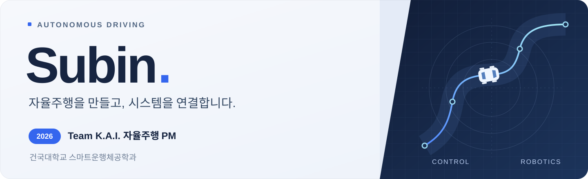
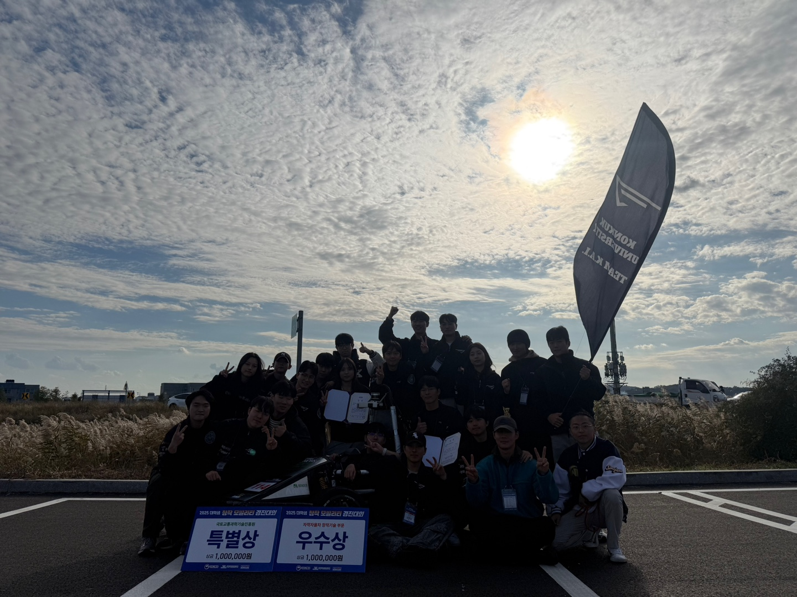

  

  <a href="#team-kai"><b>경력</b></a> &nbsp;&nbsp; / &nbsp;&nbsp;
  <a href="#awards"><b>수상</b></a> &nbsp;&nbsp; / &nbsp;&nbsp;
  <a href="#projects"><b>프로젝트</b></a> &nbsp;&nbsp; / &nbsp;&nbsp;
  <a href="#experience"><b>활동</b></a>

 

임베디드 제어와 **ROS 2**를 바탕으로 차량과 소프트웨어를 연결합니다. 현재 **Team K.A.I. 자율주행 PM**으로 활동하며, 시뮬레이션·시스템 통합·검증 도구를 개발합니다. 공간을 이해하는 지도와 UAV·UGV 협업도 연구합니다.

## 01 / Team K.A.I.

| 연도 | 역할 | 활동 |
| :--- | :--- | :--- |
| **2026** | **자율주행 PM** | 자율주행 프로젝트 관리 · 시스템 통합 |
| **2025** | **제어파트 · 회장단 총무** | ROS 2 차량 제어 · 팀 운영 · e-스마트 모빌리티 및 창작 모빌리티 대회 참가 |
| **2024** | 자율주행팀 **제어파트 파트원** | 자작자율차 개발 · 전국 대학생 창작 모빌리티 경진대회 참가 |

### Control & Integration

- **차량 통합 제어** — ROS 2와 펌웨어를 연결해 구동·조향·제동을 다루고, 수동·자율 모드와 비상정지 경로를 구성합니다.
- **임베디드 시스템** — Arduino 기반 제어에서 STM32·micro-ROS·CAN 기반 구성으로 확장하고, 계기판과 배터리 계측을 연결합니다.
- **제어기 실험** — 종·횡방향 제어, 시스템 식별, MPC와 주행 로그 분석을 진행합니다.
- **검증과 관측** — Gazebo SITL, STM 기반 HIL, 차량 상태 Web Console과 시험·튜닝 도구를 구성합니다.

2026 팀 개발 내용과 2025 공개 제어 프로젝트를 함께 소개합니다. 구성요소별 개발·검증 단계는 서로 다릅니다.

**시스템 통합** · 센서 인지와 주행 판단의 출력을 차량 제어로 연결하는 통합 구조를 다룹니다.

[2025 ROS 2 제어 저장소 ↗](https://github.com/subin11111/ros2-autonomous-control) &nbsp;·&nbsp; [TeamKAI-DL ↗](https://github.com/TeamKAI-DL) &nbsp;·&nbsp; [제어·통합 프로젝트 상세 ↗](PROJECTS.md#team-control)

## 02 / Awards & Recognition

| 이력 연도 | 대회·프로그램 | 결과 |
| :--- | :--- | :--- |
| **2026** | 국민대학교 자율주행 경진대회 | **특별상** |
| **2025** | 대학생 창작 모빌리티 경진대회 · 자작자율차 부문 | **창작기술 우수상 · 1위** |
| **2025** | 대학생 창작 모빌리티 경진대회 · 자작자율차 부문 | **자율주행성능 특별상** |
| **2025** | 건국대학교 창의설계경진대회 | **장려상 · 공학교육혁신센터장상** |
| **2025** | 2024 건국대학교 꿈(KU:Maker) 메이커 아이디어 공모전 | **최우수상 · 1위** |
| **2025** | 현대모비스 우수 SW동아리 | **Team K.A.I. 선정** |
| **2025** | 건국대학교 창의융합 캡스톤디자인 | **팀 선정** |

팀 수상·선정에는 Team K.A.I. 구성원으로 참여했습니다. KU:Maker는 대회명에 포함된 2024와 별도로, 수상 이력을 2025에 기록했습니다.

  
   
  <b>2025 대학생 창작 모빌리티 경진대회</b> · Team K.A.I. 창작기술 우수상 · 자율주행성능 특별상

## 03 / Projects

### Folded City — 공간을 잇는 지도

**RGB-D 관측에서 3차원 지도, 층간 경로와 사진 길안내까지.** iPhone의 RGB·LiDAR 깊이·ARKit 포즈를 활용해 실내외 공간을 복원하고, 여러 촬영본의 연결과 보행 경로 탐색을 연구합니다. 건국대학교 제1학생회관을 대상으로 실외 접근로·로비·계단·2층을 하나의 지도에 연결했습니다.

`Python` `OpenCV` `Open3D` `ROS 2` `Three.js` &nbsp; / &nbsp; **RGB-D SLAM · 강건 최적화 · A\* 경로 탐색**

[공개 연구 저장소 ↗](https://github.com/subin11111/folded-city-atlas-public) &nbsp;·&nbsp; [웹 지도 ↗](https://folded-city-atlas.vercel.app/) &nbsp;·&nbsp; [연구 과정 ↗](https://github.com/subin11111/folded-city-atlas-public/blob/main/README_HISTORY.md)

### UAV × UGV — 협업 시뮬레이션

**지상 주행, 비행, 탐색과 착륙을 하나의 미션으로.** PX4·Gazebo 환경과 ROS 2 워크스페이스를 연결하고, UAV·UGV의 명령 경로 분리, 센서·TF 브리지, ArUco 기반 착륙과 미션 전환을 구현·실험했습니다. 제공된 PX4/ASP 기반 환경을 확장한 프로젝트입니다.

`PX4 SITL` `Gazebo` `ROS 2` `Python` `C++` &nbsp; / &nbsp; **협업 미션 · 센서 연동 · 착륙 제어**

[ROS 2 워크스페이스 ↗](https://github.com/subin11111/asp_ws) &nbsp;·&nbsp; [PX4·Gazebo 환경 ↗](https://github.com/subin11111/asp/tree/jsb)

### More things I build

| 프로젝트 | 무엇을 만들었는가 | 저장소 |
| :--- | :--- | :--- |
| **ROS 2 Autonomous Control** | Arduino VCU, 구동·조향, CAN·시리얼 통신을 연결한 차량 통합 제어 | [ros2-autonomous-control](https://github.com/subin11111/ros2-autonomous-control) |
| **Autonomous Driving Platform** | 차선 인식·주행 명령·MCU 통신을 연결하는 ROS 2 통합 플랫폼 | [autonomous-driving-platform](https://github.com/subin11111/autonomous-driving-platform) |
| **Life Map Diary** | 전국 읍면동별 일상·사진 기록과 통계를 쌓는 개인 지도 서비스 | [travel-map-diary](https://github.com/subin11111/travel-map-diary) |
| **GOBBLEFIN** | 물고기를 먹고 성장하는 Canvas 기반 실시간 경쟁 웹 아케이드 | [gobblefin](https://github.com/subin11111/gobblefin) · [플레이](https://gobblefin-reef-arena.hazy-skink-6279.chatgpt.site) |
| **Bike Anomaly** | 이상 탐지와 조기 경보를 위한 비지도 학습·ML·DL 비교 실험 | 비공개 · 연구 요약 |

Folded City의 연구·공개 저장소와 ASP의 시뮬레이터·ROS 2 저장소는 각각 하나의 프로젝트로 묶었습니다.

[전체 프로젝트와 기술 상세 보기 ↗](PROJECTS.md)

## 04 / Experience & Activities

<b>2026 · Project management & autonomous systems</b>

- 건국대학교 Team K.A.I. 자율주행 **PM**
- **국민대학교 자율주행 경진대회 특별상**
- 대학생 AI·SW 모빌리티 경진대회 자작자율차 부문 관련 활동
- **Folded City** — 건국대학교 학술공모전 성(誠) 분야, 실내외 지도·경로 탐색 연구

<b>2025 · Vehicle control & team operations</b>

- 건국대학교 Team K.A.I. 자율주행팀 **회장단 총무 · 제어파트**
- **현대모비스 우수 SW동아리 Team K.A.I. 선정**
- **2024 건국대학교 꿈(KU:Maker) 메이커 아이디어 공모전 최우수상 · 1위**
- 건국대학교 **창의융합 캡스톤디자인팀 선정**
- 건국대학교 **창의설계경진대회 장려상 · 공학교육혁신센터장상**
- KASE 대학생 e-스마트 모빌리티 경진대회 참가
- 대학생 창작 모빌리티 경진대회 자작자율차 부문 **창작기술 우수상 · 1위**
- 같은 대회 **자율주행성능 특별상**
- 건국대학교 학생복지위원회 **‘여정’ 대외협력국 국원**
- 학생복지위원회 **2025학년도 1학기 복지장학금 TF팀**

<b>2024 · The beginning</b>

- **건국대학교 스마트운행체공학과 정시 입학**
- 건국대학교 Team K.A.I. 자율주행팀 **제어파트 파트원**
- 전국 대학생 창작 모빌리티 경진대회 **자작자율차 부문 참가**
- 제8회 공군참모총장배 드론 종합경진대회 **드론클래쉬 기체제작 아이디어 발표회 참가**
- 같은 대회 **드론클래쉬 챔피언쉽 ROKAF 참가**
- KU융합과학기술원 제8대 학생회 **‘에이트’ 대외협력국 국원**
- KU융합과학기술원 체육대회 **‘KIT LAND’ 진행**
- KU융합과학기술원 축제 **‘KITEUK KITEUK’ 진행**

## 05 / Toolbox

| 분야 | 사용 기술 |
| :--- | :--- |
| **Control & Embedded** | C / C++ · Python · STM32 · Arduino · micro-ROS · CAN · UART |
| **Robotics & Simulation** | ROS 2 · Gazebo · PX4 · SITL / HIL · RViz · Foxglove |
| **Mapping & Vision** | RGB-D · OpenCV · Open3D · NumPy · SciPy · PyTorch |
| **Web & Visualization** | TypeScript · React · Next.js · Three.js · MapLibre · Supabase |

---

  <b>Build it. Connect it. Test it.</b> subin11111 · Konkuk University · Team K.A.I.

